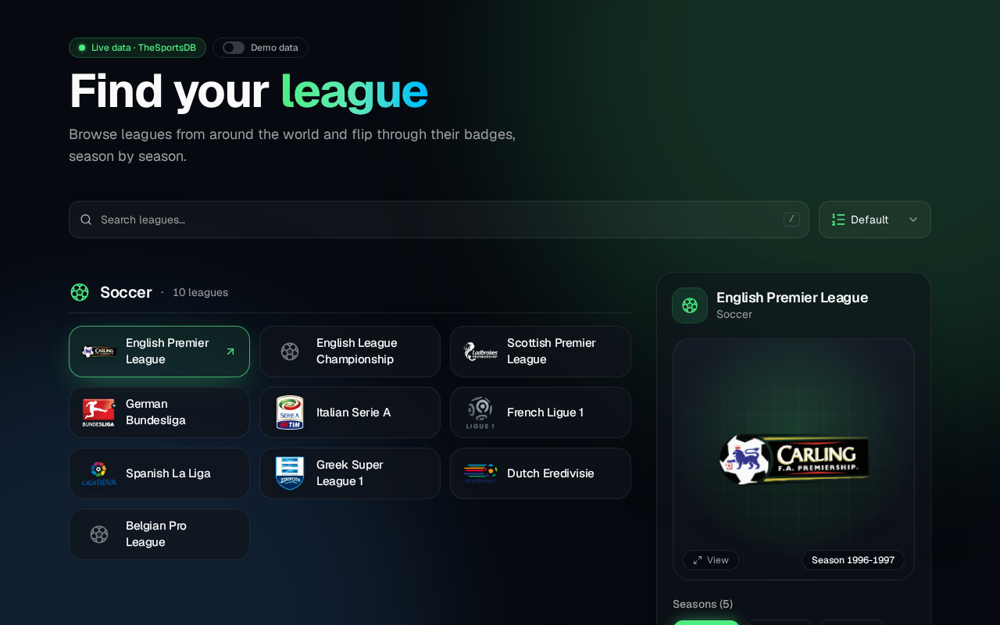
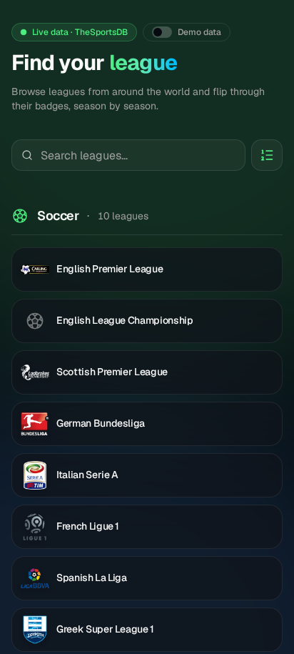

# Sports Leagues

[](https://github.com/pawcza/sports-leagues/actions/workflows/ci.yml)

**Live: https://pawcza.github.io/sports-leagues/**

A single-page app that lists sports leagues from [TheSportsDB](https://www.thesportsdb.com/free_sports_api), lets you search and filter them, and shows season badges for the selected league.

| Desktop | Phone |
|---|---|
|  |  |

```bash
pnpm install     # Node ^20.19 or >=22.12 (see .nvmrc); npm/yarn also work, pnpm is what the lockfile targets
pnpm dev         # http://localhost:5173
pnpm test        # unit + component tests (API mocked with MSW)
pnpm e2e         # Playwright smoke tests at phone and desktop widths (API mocked; first run: pnpm exec playwright install chromium)
pnpm build       # type-check + production build
```

## About the free API key

The brief's `123` test key is capped, and that shapes what you can see:

| Endpoint | What the free key returns |
|---|---|
| `all_leagues.php` | **10 leagues, all Soccer**: so the sport dropdown (which the brief says to show only when several sports appear) is correctly hidden |
| `search_all_seasons.php?badge=1&id=…` | only the **5 oldest seasons** of a league (e.g. EPL: 1992-93 → 1996-97), so "latest badge" below means the latest one the API returns |
| any | rate limited per IP; over the limit the API answers 429 without CORS headers, which browsers report as a CORS error |

Two ways to see the full UI anyway:

- **Demo data toggle:** the switch in the header adds leagues from four more sports, so you can see the sport dropdown and several categories. Demo leagues have no real badges and cost no API requests.
- **Premium key:** copy `.env.example` to `.env` and set `VITE_SPORTSDB_KEY`. All leagues, sports and seasons then come from the real API (no code change). Leagues with more than 12 seasons get a season filter.

## What it does

- **List:** leagues (`strLeague`) grouped into one section per sport (`strSport`, shown once in the section header with its icon and league count instead of on every card), with a search box, a sport dropdown (icons + counts), a Default / A–Z / Z–A sort and a Reset button.
- **Badge:** clicking a league shows its season badge (latest season by default), a season picker, and a full-screen view that morphs out of the thumbnail (native View Transitions API on a native `<dialog>`; plain open/close where unsupported).
- **Responsive:** 1 / 2 / 3 grid columns, a sticky toolbar, category headers that dock on phones and tablets, a side panel on desktop and a bottom sheet on mobile.
- **States and a11y:** skeletons, error states with retry, empty states, real buttons (`aria-pressed`), a live result count, `prefers-reduced-motion` respected.

## When requests happen (and caching)

All responses are cached with TanStack Query and persisted to `localStorage` (24 h, per API key), so a reload costs zero requests while the cache is fresh.

- Leagues: one request on first load (4 h `staleTime`, mirroring the API's own `cache-control`). In `pnpm dev` StrictMode fires it twice; a production build does not.
- Cold first load with the free key is therefore **11 requests**: 1 for the list plus 10 badge lookups, one per league card, to draw each card's thumbnail. After that everything comes from the cache.
- Badges, **one request per league, at most once**: fetched when that league's card scrolls near the viewport (to draw its thumbnail), when you hover or focus a card for 250 ms (prefetch), or when you click it. Clicking therefore usually *hits the cache* instead of the network; the Season Badge API is still called with the league id, just earlier.
- Concurrent requests for the same key are de-duplicated.

## State management

- **Server state:** TanStack Query (leagues, season badges), cached and persisted as described above.
- **UI state:** one small typed [Zustand](https://github.com/pmndrs/zustand) store (`src/store/ui.ts`) holding the search text, sport filter, sort, the selected league and the demo flag. It is not persisted, so every load starts from the default view. Components subscribe to just the slice they need, so typing in the search box re-renders the list and toolbar but not, say, the badge panel.
- **Derived data** (`filter → sort → group`) is computed with `useMemo` from the two sources above, using the pure functions in `lib/filter.ts`.
- **Selection rule inside the store:** a selected league that a new search or sport filter would hide is cleared by the store's own actions (a pure function, unit tested), rather than by an effect in a component.
- **Component-local state** stays local: the chosen season, the season filter text and whether the full-badge view is open.

## Design decisions

- **Stack:** React 19, Vite, strict TypeScript, Tailwind 4, shadcn/ui (Base UI), TanStack Query, Zustand, motion, Phosphor icons for sports and lucide for UI chrome. Tests: Vitest, Testing Library, MSW, Playwright.
- **Structure:** `lib/api.ts` is the only code that touches `fetch`; `lib/queries.ts` owns caching; `lib/filter.ts` holds pure filter / sort / group functions (unit tested); `store/ui.ts` is the UI state. `App` only derives what to show and composes `PageHeader`, `Toolbar` (with `Filters`), `LeagueList` (with `SportSection` and `LeagueCard`), and `BadgeAside` / `BadgeSheet` (both wrap `BadgePanel`, which uses `SeasonPicker` and `BadgeViewer`).
- **Null-safe API handling:** `strBadge: null` seasons are dropped, `seasons: null` (unknown league) shows an empty state.
- **Motion:** entrance stagger, layout animation when filters reshuffle the list, blur-in badges, spring season pill, view-transition badge view. Motion features, each sport's icon, and the badge panel / mobile sheet are code-split, so the entry chunk is ~340 kB (110 kB gzipped).

## Not done

- Highlighting the matched text in search results.
